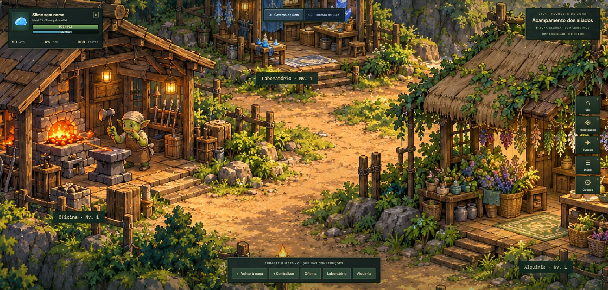
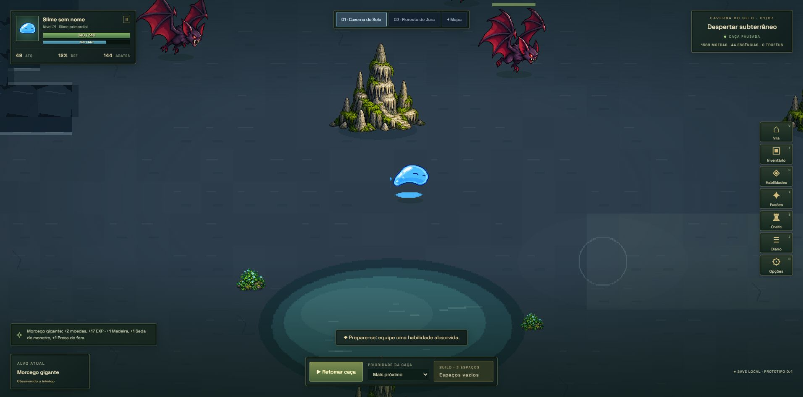
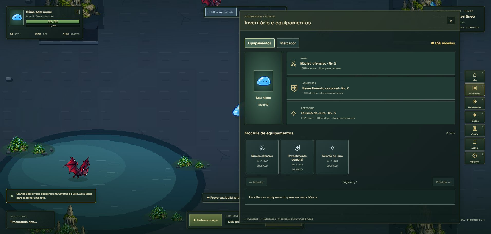
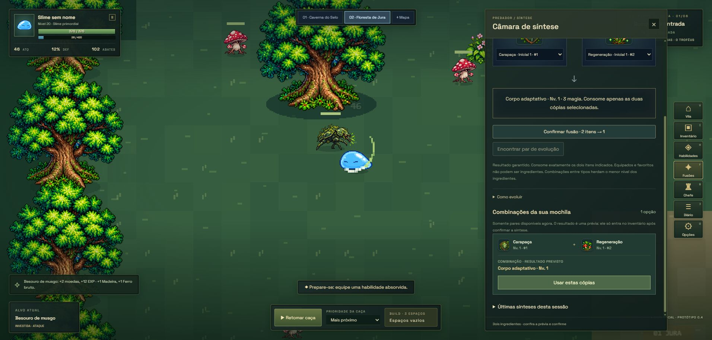

# Slime · Origens

RPG idle para navegador em que um slime transforma criaturas derrotadas em novas habilidades e recursos para desenvolver sua vila.

Explore a **Caverna do Selo** e a **Floresta de Jura**, monte sua build, combine poderes e prepare-se para enfrentar chefes. O personagem caça automaticamente; você decide onde explorar e como evoluir.



## Sobre o jogo

Slime · Origens é um protótipo individual desenvolvido com **Phaser 3, TypeScript e Vite**. A proposta combina exploração em visão superior, combate automático e progressão por absorção, com referências visuais de RPGs como Tibia e inspiração temática em *That Time I Got Reincarnated as a Slime*.

O ciclo principal é:

**Escolher uma região → caçar → absorver habilidades e coletar materiais → preparar a build → melhorar a vila → enfrentar novos desafios.**

### Recursos disponíveis

- **Exploração:** sete setores na caverna e seis regiões conectadas na floresta, com criaturas e materiais próprios de cada ambiente.
- **Caça automática:** seleção de prioridade, navegação entre regiões, pausa e exploração automática após seis abates no setor.
- **Absorção:** habilidades como cópias individuais, com níveis, favoritos e identidade própria.
- **Build:** três espaços de habilidades e seis pontos de capacidade mágica, além de arma, armadura e acessório.
- **Síntese:** evolução de cópias iguais e receitas entre habilidades diferentes, com prévia antes de consumir os ingredientes.
- **Vila de Tempest:** moradores interativos, oficina, laboratório, alquimia e melhorias permanentes.
- **Forja e comércio:** fabricação de equipamentos e negociação com Myourmiles, cuja caravana renova as ofertas a cada 15 minutos.
- **Chefes:** Serpente Negra Anciã na caverna e Guardião da carapaça na floresta.
- **Continuidade:** save local, migração de versões anteriores, exportação/importação e recompensas limitadas por ausência.

## Executar localmente

### Requisitos

- **Node.js 22.18+ na série 22, ou Node.js 24+**, para executar também os testes com remoção nativa de tipos.
- **npm**.

Na pasta do projeto:

```bash
npm install
npm run dev
```

Abra o endereço informado pelo Vite, normalmente **http://127.0.0.1:5173/**.

### Comandos

| Comando | Função |
| --- | --- |
| `npm run dev` | Inicia o servidor local de desenvolvimento. |
| `npm test` | Executa os testes automatizados das regras e dos assets. |
| `npm run build` | Verifica os tipos e gera a versão de produção em `dist/`. |
| `npm run preview` | Serve o build de produção para conferência local. |

Para conferir a versão de produção:

```bash
npm run build
npm run preview
```

A pasta `dist/` pode ser publicada em uma hospedagem estática. Abra o jogo por um servidor HTTP; abrir `index.html` diretamente por `file://` não substitui esse fluxo.

## Como jogar

O slime procura inimigos, anda e ataca sozinho. Use o seletor de prioridade para buscar uma espécie e suas habilidades. O objetivo exibido acima da barra de caça indica a próxima ação e pode ser clicado para abrir o sistema correspondente.

| Controle | Ação |
| --- | --- |
| **I** | Abrir inventário e equipamentos. |
| **H** | Consultar habilidades e organizar a build. |
| **F** | Abrir a Câmara de Síntese. |
| **V** | Visitar a vila ou retornar à caça. |
| **B** | Consultar o desafio de chefe. |
| **J** | Abrir o diário da expedição. |
| **O** | Abrir opções, áudio, tela cheia e gerenciamento de save. |
| **Esc** | Fechar o painel aberto. |
| **Mapa** | Consultar regiões, recursos e destinos de viagem. |

Na vila, arraste para explorar o cenário, use a roda do mouse para ajustar o zoom e converse com os moradores. A caça fica suspensa durante a visita.

### Habilidades, equipamentos e síntese

Cada habilidade absorvida entra na mochila como uma cópia independente. Escolha um espaço da build e aloque a cópia desejada. **A cópia exata equipada define seu poder:** obter outra mais forte não troca automaticamente a build.

Há três espaços e seis pontos de magia. Na síntese, duas cópias iguais e do mesmo nível podem evoluir; combinações entre tipos seguem receitas e herdam o menor nível dos ingredientes. As habilidades possuem nove níveis, organizados em três estágios: Inicial, Superior e Evoluída.

A interface mostra a prévia e as combinações possíveis com a mochila atual. Itens equipados e favoritos ficam protegidos contra fusão e venda. Equipamentos fabricados por Kaijin entram na mochila e precisam ser equipados para conceder seus bônus.

### Vila, coleta e chefes

Funde a vila após dez abates e acolha Kaijin após vinte. Desenvolva a oficina, o laboratório e a alquimia. Consulte o atlas para descobrir onde coletar os materiais necessários às receitas e visite Myourmiles para negociar usando moedas do jogo.

Os desafios de chefe exigem nível 3 e absorções de três espécies. Prepare a build antes de entrar: alterações de habilidades, equipamentos e negociações são restringidas durante o combate. Uma derrota não remove o progresso acumulado.

## Telas do projeto

### Caverna e exploração



### Inventário e equipamentos



### Síntese de habilidades



As capturas representam estados de desenvolvimento e partidas com progresso; valores e itens exibidos não correspondem necessariamente ao início de uma aventura.

## Tecnologias e organização

| Tecnologia | Aplicação |
| --- | --- |
| **TypeScript** | Regras, estados, cenas e interfaces, com verificação estrita de tipos. |
| **Phaser 3** | Renderização 2D, sprites, animações, câmera e entrada. |
| **Vite** | Servidor de desenvolvimento e build de produção. |
| **HTML e CSS** | HUD, menus, filtros, barras e janelas sobrepostas ao mundo. |
| **APIs do navegador** | Persistência em `localStorage`, áudio sintetizado e tela cheia. |
| **Node Test Runner** | Testes automatizados das regras e dos assets. |
| **Python e Pillow** | Scripts auxiliares de preparação de assets e atlas. |

```text
src/            Regras, cenas, navegação e interface
public/assets/  Imagens, sprites e atlas servidos ao navegador
scripts/        Ferramentas de assets e dados de demonstração
tests/          Testes automatizados
documentação/   Planejamento, decisões, prompts e capturas
```

O mundo é desenhado pelo Phaser, enquanto os menus usam HTML/CSS. As regras estão distribuídas em módulos de progressão, inventário, síntese, recursos, vila e economia. `src/app.ts` integra os sistemas, as cenas e o salvamento.

## Desenvolvimento com apoio de IA

O projeto foi desenvolvido com apoio do **Codex**, orientado pelas decisões e regras definidas pelo autor: plataforma web, Phaser com TypeScript, mapa ocupando a janela, menus dentro do jogo e combate automático como base da experiência.

O processo seguiu ciclos de **prototipação incremental**: definir uma funcionalidade, implementar, executar verificações, observar o resultado no navegador e revisar. O Codex apoiou a implementação, investigação de problemas, testes e documentação; as prioridades, referências e avaliações foram conduzidas pelo autor.

Parte dos assets foi gerada com **Imagegen**, a partir de referências e prompts registrados na documentação. A folha original do slime foi fornecida pelo autor e preservada. A integração incluiu atlas, recortes, transparência, proporções e animações. Não foram utilizados assets extraídos de Tibia.

## Salvamento e limites atuais

O progresso fica no armazenamento local do navegador, com salvamento periódico e migração de saves antigos. Use **Opções → Exportar save** para guardar uma cópia e importar ou restaurar depois.

- Navegadores, perfis e origens diferentes mantêm saves separados. `localhost` e `127.0.0.1` não compartilham o mesmo armazenamento.
- A expedição por ausência depende das condições da partida, usa ritmo reduzido e limita as recompensas a duas horas e 240 abates. Não explora regiões novas nem enfrenta chefes.
- O jogo é um protótipo individual, sem contas, sincronização em nuvem ou mercado entre jogadores. A economia utiliza apenas moedas internas.
- Saves locais são editáveis e não representam inventário validado por servidor. O uso simultâneo em várias abas não é suportado.

## Documentação

| Tema | Documento |
| --- | --- |
| Proposta e decisões iniciais | [Planejamento](documentação/planejamento.md) |
| Inventário, cópias, equipamentos e moeda | [Inventário e economia](documentação/inventario-e-economia.md) |
| Fabricação, materiais e continuidade da caça | [Forja e recursos](documentação/forja-recursos-continuidade.md) |
| Regiões, criaturas e coleta | [Floresta de Jura](documentação/floresta-de-jura.md) |
| Origem da arte e integração de animações | [Sprites](documentação/sprites.md) |
| Preparação, impacto e recuperação dos ataques | [Combate visual](documentação/combate-visual.md) |
| Moradores e direção visual da vila | [Arte de Tempest](documentação/vila-sprites-anime-v2.md) |
| Ofertas e estabilidade da interface | [Ícones, caravana e menus](documentação/icones-caravana-menus.md) |

Os registros documentam suas respectivas etapas. Para o comportamento atual, confira a versão em execução e o código-fonte.
