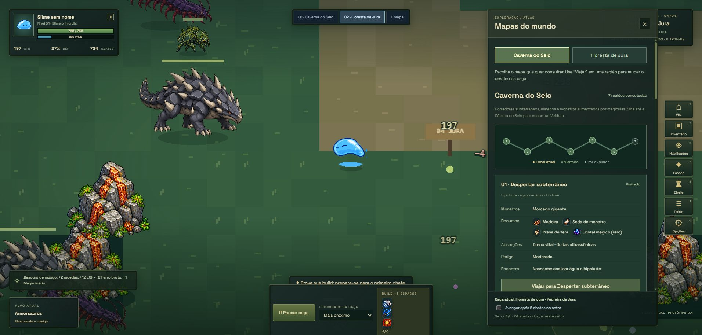

# Atlas separado e proporções das criaturas

## Consulta dos mapas

A floresta havia recebido informações novas enquanto a caverna mantinha o formato antigo. Agora ambas usam o mesmo componente de apresentação e os mesmos campos: monstros, recursos, absorções, perigo e encontros especiais.

**Mapa** abre o atlas com duas abas: **Caverna do Selo** e **Floresta de Jura**. Uma seção fica visível por vez, com seu percurso, números de região e estados Aqui / Visitado / Por explorar. Trocar a aba consulta outro mapa sem alterar o lugar da caça. Somente **Viajar para…** escolhe um destino, seguindo as rotas existentes. As abas também funcionam com setas, Home e End.

A localização da caça e a opção de avançar após seis abates permanecem no rodapé, identificadas como informações da caça atual. A seleção da aba e a rolagem não são reconstruídas por novos abates. A nascente e o encontro com Veldora pertencem exclusivamente à seção da caverna.

`src/map-guide.ts` fornece os mesmos dados às duas seções. Recursos são obtidos da tabela real de loot para o habitat e as espécies da região. Materiais exclusivamente probabilísticos recebem a indicação “raro”. Absorções usam a tabela de habilidades da espécie, incluindo habilidades alternativas, como Fio de aço.

## Escala visual

As medidas são relativas ao corpo neutro da folha de sprites, em pixels do mundo; o zoom da câmera multiplica todos os personagens igualmente. A largura de uma criatura alada ou alongada não representa seu raio de contato. A mesma escala é preservada entre as poses da animação.

| Criatura | Largura | Relação com o slime |
| --- | ---: | ---: |
| Slime | 36 | 1× |
| Vaga-lume | 18 | 0,5× |
| Cogumelo | 27 | 0,75× |
| Sapo | 34 | 0,94× |
| Besouro | 38 | 1,06× |
| Mariposa (asas) | 42 | 1,17× |
| Serpente púrpura | 62 | 1,72× |
| Morcego (asas) | 72 | 2× |
| Lobo terrível | 78 | 2,17× |
| Aranha negra | 88 | 2,44× |
| Centopeia | 96 | 2,67× |
| Serpente negra | 112 | 3,11× |
| Armorsaurus | 118 | 3,28× |
| Guardião | 164 | 4,56× |
| Serpente Anciã | 210 | 5,83× |

`src/actor-sizes.ts` centraliza essa direção visual. São proporções de leitura para o jogo, sem representar medidas canônicas em metros.

Sombras seguem a área de apoio no chão. A barra de vida usa a altura real da pose neutra e uma largura proporcional ao sprite. O alcance corpo a corpo considera os raios de contato do slime e do inimigo, evitando usar a mesma distância para um vaga-lume e um chefe. A validação do impacto permite uma pequena margem de movimento durante o golpe. Ataques inimigos corpo a corpo e sua aproximação também respeitam esse alcance. Efeitos e números de dano foram reposicionados de acordo com a altura do monstro.

## Verificação

64 testes passaram, incluindo seções separadas, informações equivalentes, recursos por habitat, absorções alternativas, proporções, barras acima do corpo e alcance dos chefes. Build de produção aprovado, com o aviso conhecido de tamanho do bundle Phaser.

No Edge, a aba Caverna foi consultada com a caça ainda na Pedreira de Jura; a outra seção ficou oculta. Navegação por teclado entre abas foi conferida. Clicar em Viajar para Despertar subterrâneo mudou explicitamente para a caverna e iniciou a rota até o setor 1. O combate seguiu recebendo recompensas com o atlas aberto. A captura mostra o atlas e a relação entre slime, besouro, centopeia e Armorsaurus no mundo.

