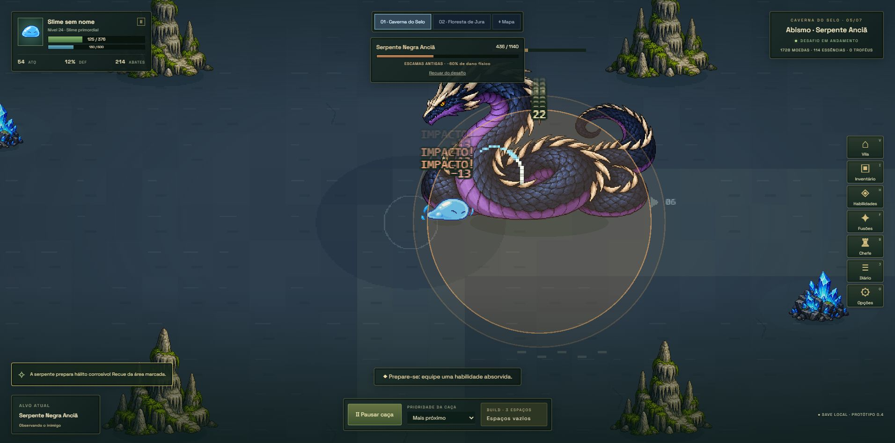

# Ataque da Serpente Anciã

A folha anterior tinha parte da cauda do quadro inferior direito dentro da área usada pelo quadro inferior esquerdo. O recorte em quatro células incluía esse pedaço vizinho, criando a impressão de uma parte traseira solta na frente do chefe.

A ferramenta integrada ImageGen gerou `public/assets/sprites/cave-serpent-boss-v2.png`, com quatro poses separadas e a cauda atrás do corpo em todas elas. A versão anterior foi preservada. [Prompt completo](prompt-chefe-ataque-v2.json).

`scripts/build-cave-boss-atlas.py` valida a separação entre células e grava apenas metadados. O atlas usa uma referência horizontal fixa e a mesma linha de apoio para todas as poses; não recentraliza o corpo conforme o peso visual da cabeça. O PNG permanece sem alterações.

O corpo enrolado agora permanece plantado no chão, sem o alongamento, rotação ou deslocamento genéricos usados nas investidas de outros monstros. O pescoço se move pela própria animação. A orientação e a mira desse chefe permanecem as escolhidas no início da preparação, evitando inverter corpo e cauda no meio do golpe.

75 testes passaram, incluindo limites dos quatro recortes, dimensões lógicas comuns e linha de apoio constante. Build aprovado, com o aviso conhecido de tamanho do bundle Phaser. No Edge, em `localhost`, foi iniciado o desafio e observado o quadro de ataque sem o pedaço de cauda do vizinho.

