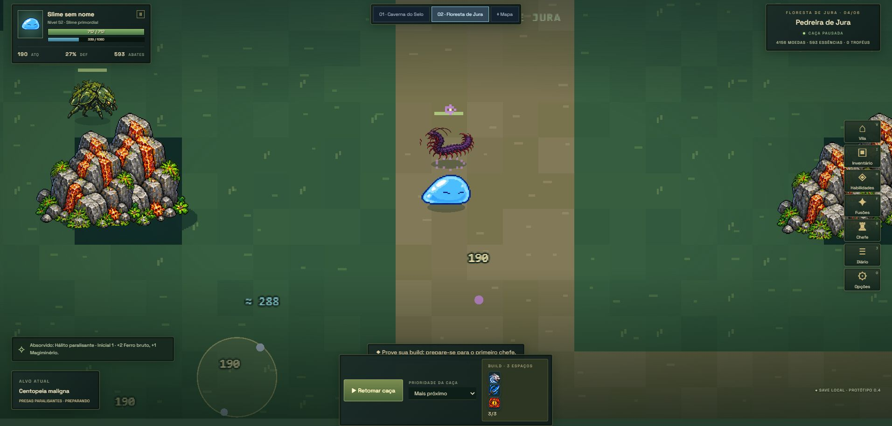

# Floresta de Jura — regiões e recursos

A antiga clareira de 800 × 480 foi substituída por um mundo de 8320 × 2304, com seis regiões conectadas, câmera acompanhando Rimuru, trilhas, lago atravessável pelo caminho seco e obstáculos reais. O mesmo fluxo de exploração da caverna agora funciona na floresta: escolher destino no Mapa ou avançar após seis abates. Desligar a exploração automática permite permanecer coletando no setor e essa preferência fica salva.

| Região | Espécies | Coleta e partes dos monstros |
| --- | --- | --- |
| Bosque de entrada | Cogumelo vital, besouro de musgo | Madeira; cogumelos dão hipokute, besouros dão ferro |
| Margens do riacho | Sapos, serpentes púrpuras, cogumelos | Hipokute; couro dos sapos, presas das serpentes |
| Território dos lobos | Lobos terríveis e serpentes púrpuras | Madeira, couro dos lobos, presas |
| Pedreira de Jura | Besouros, centopeias malignas, Armorsaurus | Ferro e magiminério; couro e escamas raras do Armorsaurus |
| Ninho das tecelãs | Aranhas negras e mariposas | Madeira e seda; cristais raros das mariposas |
| Coração mágico | Vaga-lumes elétricos, mariposas, serpentes negras | Cristais; seda das mariposas, presas e escamas raras das serpentes |

A coleta ambiental ocorre junto aos abates e aparece somada no aviso de loot. Não representa uma parte retirada do corpo do monstro. A regra da floresta não concede madeira em todas as regiões, nem magiminério fora da pedreira. Partes seguem a espécie efetivamente derrotada. Mariposas têm 20% de chance de cristal, serpentes negras têm 25% de escama e Armorsaurus tem 15% de escama. Hipokute dos cogumelos fornece duas unidades, além da eventual coleta ambiental. Absorção de habilidades continua usando a tabela da espécie, com sua garantia de cópias.

O guardião de carapaça é uma variante criada para o jogo e ocupa a arena no coração mágico. Ele concede oito ferro, quatro magiminério, dois cristais, dez essências, cem EXP e um troféu. As três escamas garantidas pertencem ao chefe serpente da caverna. A descrição do desafio mostra as recompensas correspondentes.

Os encontros e a distribuição das regiões são adaptações para o jogo inspiradas em Jura. Lobos terríveis, aranhas negras, serpentes e criaturas de carapaça usam as folhas anime já existentes. Nenhum aliado de Tempest foi convertido em inimigo.

## Arte e navegação

A ferramenta integrada ImageGen gerou carvalho, salgueiro, afloramento de ferro, cristais mágicos, hipokute e tronco caído. A folha final com transparência é `public/assets/sprites/forest-decor-anime-v2.png`. [Prompts completos](prompts-jura.json). O script `scripts/build-forest-atlas.py` mede os recortes e grava somente metadados; preserva a imagem original.

A geometria do chão é desenhada uma vez em blocos; os props ficam em imagens com descarte fora da câmera. Árvores, rochas e lago compartilham o modelo de colisão com a navegação. Spawns são escolhidos de uma lista de posições caminháveis por região. Ataques e deslocamentos respeitam linhas bloqueadas. A câmera ajusta a suavização ao tempo decorrido para acompanhar Rimuru também com frames lentos.

## Persistência e verificação

Saves antigos recebem a floresta no setor inicial. Região atual e áreas visitadas de floresta e caverna são preservadas independentemente. A área ativa também é restaurada ao recarregar. Checkpoints de ausência incluem ambiente e setor: retornar à aba ou carregar o save mantém a tabela de coleta da região.

61 testes passaram, incluindo rotas entre todas as seis regiões, alcance de todos os pontos de spawn, colisão com água e obstáculos, migração, loot por espécie/ambiente, checkpoints e atlas. Build de produção aprovado; permanece o aviso conhecido de tamanho do bundle Phaser.

No Edge, em `localhost` separado do save de `127.0.0.1`, foram conferidos avanço automático do bosque ao riacho, viagem manual à pedreira, permanência no setor e recebimento de ferro/magiminério. A recarga restaurou a área da floresta. O guia mostra monstros, perigo e recursos por região.

