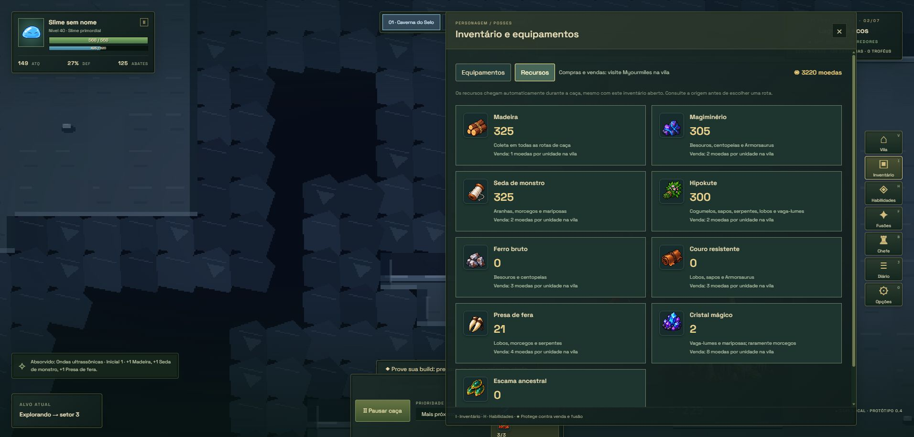

# Forja, recursos e continuidade da caça

Kaijin oferece nove receitas: arma, armadura e amuleto nas qualidades Simples, Forjado e Obra-prima. A qualidade é escolhida explicitamente, mesmo com oficina máxima. É necessário fundar a vila, recrutar Kaijin e alcançar o nível de oficina correspondente. Fabricar entrega uma cópia na mochila; equipar continua sendo uma escolha do jogador.

| Qualidade | Arma | Armadura | Amuleto |
| --- | --- | --- | --- |
| Simples | 80 moedas | 90 moedas | 100 moedas |
| Forjado | 120 moedas, 12 ferro, 4 magiminério, 4 presas | 120 moedas, 10 ferro, 10 couro, 6 seda | 120 moedas, 8 cristais, 4 magiminério, 6 seda, 8 hipokute |
| Obra-prima | 350 moedas, 18 magiminério, 20 ferro, 8 cristais, 12 presas | 350 moedas, 16 magiminério, 16 ferro, 18 couro, 6 escamas | 350 moedas, 12 magiminério, 16 cristais, 4 escamas, 12 seda |

Nenhum custo é descontado se faltar moeda, recurso ou requisito. Receitas mostram quantidades disponíveis e faltantes. Saves antigos preservam os materiais existentes e recebem os novos tipos zerados.

## Coleta e comércio

A aba **Recursos**, no inventário, mostra os nove materiais, suas fontes e preços. As contagens recebem atualizações sem reconstruir o menu durante o combate.

- Madeira: todas as caçadas.
- Magiminério: besouros, centopeias e Armorsaurus.
- Seda: aranhas, morcegos e mariposas.
- Hipokute: os demais tipos; cogumelos fornecem duas unidades.
- Ferro: besouros e centopeias.
- Couro: lobos, sapos e Armorsaurus.
- Presas: lobos, morcegos e serpentes.
- Cristais: vaga-lumes e mariposas; 10% nos morcegos.
- Escamas: 25% nas serpentes negras e 15% no Armorsaurus. Vitória contra chefe fornece três escamas e dois cristais.

Myourmiles compra recursos por quantidade, com prévia e confirmação da venda. A caravana também pode oferecer os novos materiais. Preços de compra superam os valores de revenda.

Os nove ícones foram gerados com a ferramenta integrada ImageGen, usando o atlas de equipamentos como referência. Arquivo: `public/assets/sprites/icons-resources-anime-v1.png`. O prompt completo está em [prompt-recursos.json](prompt-recursos.json). A folha original foi preservada, com recortes via CSS.

## Caça e foco da janela

A simulação visível usa tempo decorrido em passos de até 50 ms, recuperando até dois segundos por frame após atrasos. Não depende do foco do teclado. Ao voltar à aba, o relógio do Phaser e os relógios de navegação são reiniciados e a caça retoma automaticamente, respeitando a pausa manual.

Com a aba oculta, não se executa combate visual: uma expedição acumula recompensas a 50% do ritmo observado. Antes de haver observação suficiente, usa uma estimativa baseada no ataque e no inimigo atual. O limite é de duas horas e 240 abates por ausência; vila, pausa, recuperação e chefe não iniciam essa expedição. Não avança setores nem concede vitórias contra chefes. Um cursor persistido impede receber duas vezes os mesmos abates entre os ticks, o retorno e o carregamento do save.

Alvos próximos atrás de colunas agora exigem uma rota de aproximação. Passos não atravessam obstáculos; o início da rota considera a posição dentro do tile. Após seis segundos sem movimento nem dano, o caçador recalcula a rota e evita temporariamente o alvo bloqueado. Dano ou movimento reiniciam essa contagem.

## Validação

55 testes passaram, incluindo custos exatos das nove receitas, falhas sem consumo, migração, fontes de recursos, vendas, contabilidade de ausência, aproximação bloqueada e recuperação de rota. `npm run build` passou; permanece o aviso de tamanho do bundle Phaser.

No Edge, em `localhost` separado do save em `127.0.0.1`, foi fabricada uma espada simples: saldo de 3274 para 3194 moedas, sem consumo de materiais. Receitas forjadas exibiram os materiais ausentes e ficaram bloqueadas. Com Recursos aberto durante a caça, chegaram madeira, magiminério e ferro, e a exploração avançou entre setores. A troca física de monitor não foi reproduzida; a perda de foco e o progresso de ausência têm cobertura das regras de tempo e retomada.

