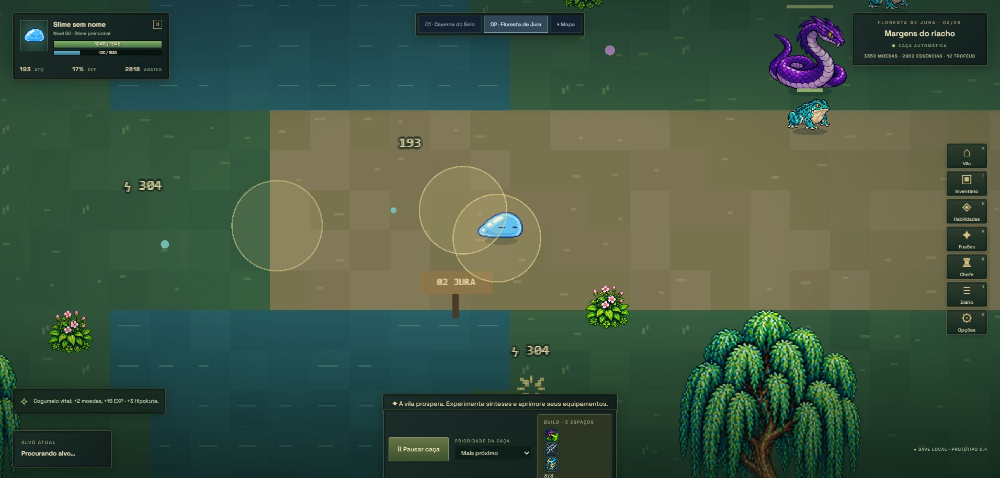
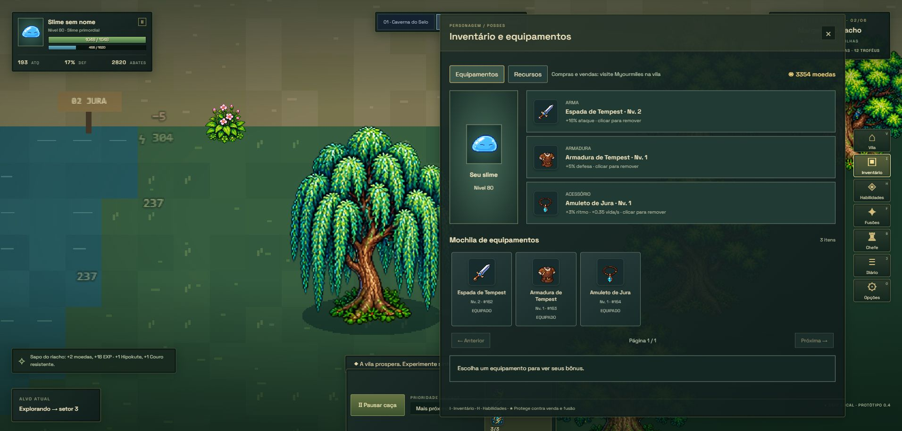
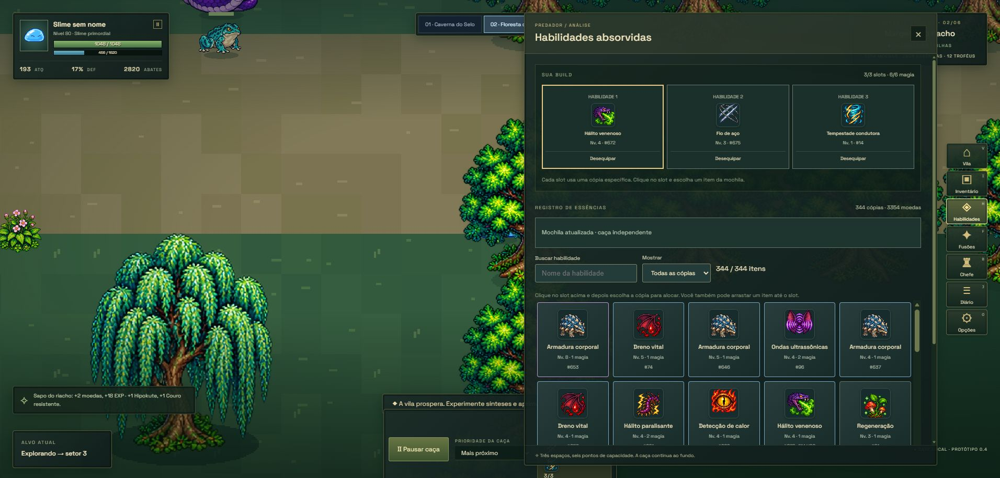
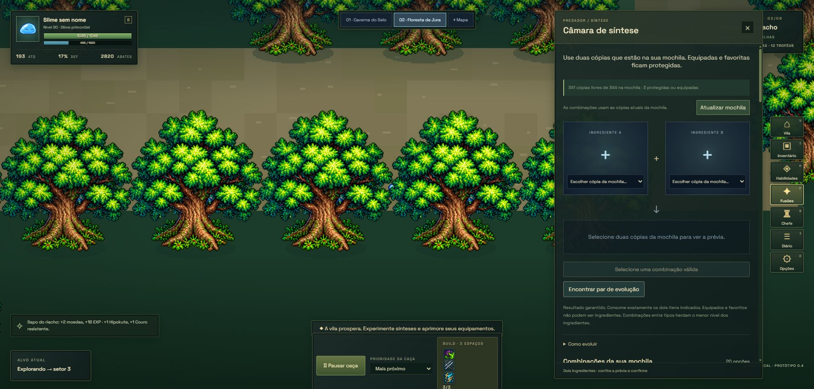
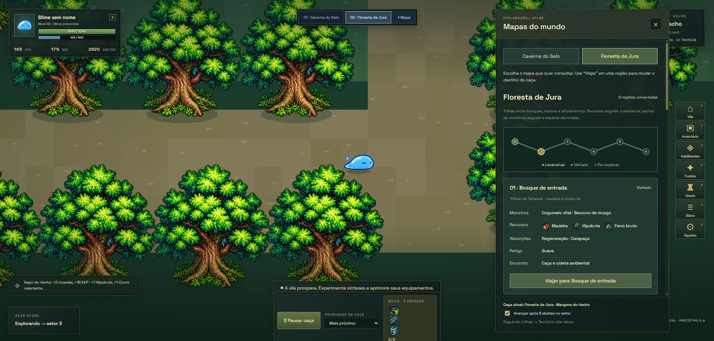
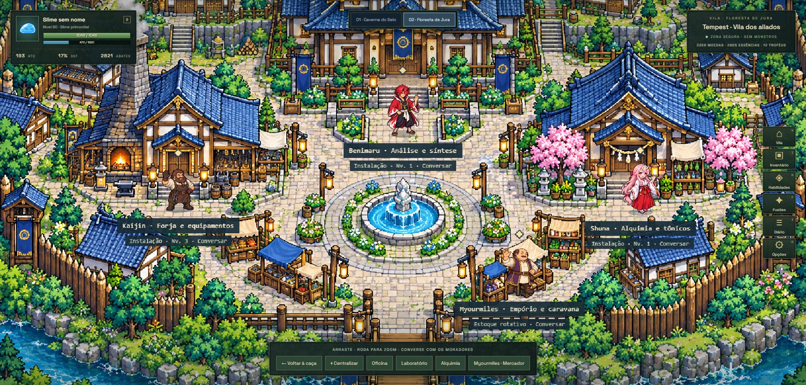
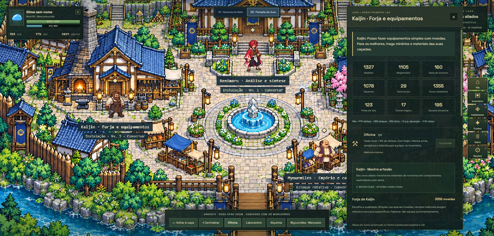
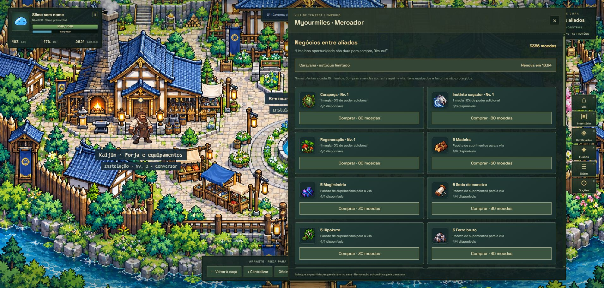
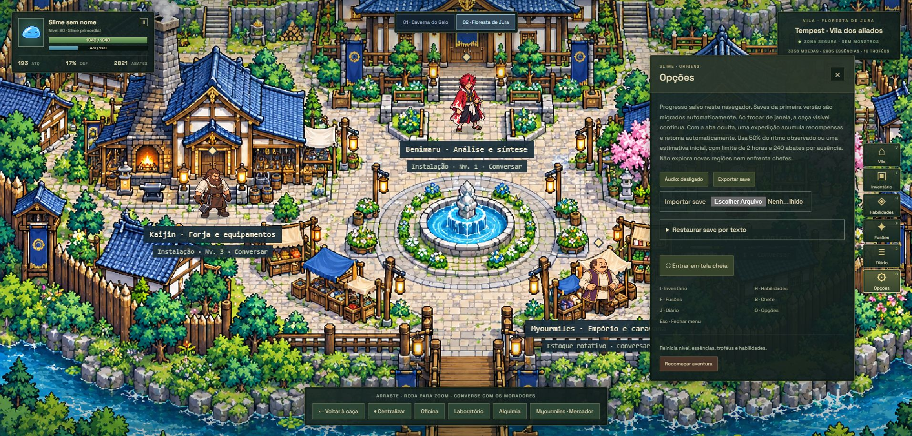
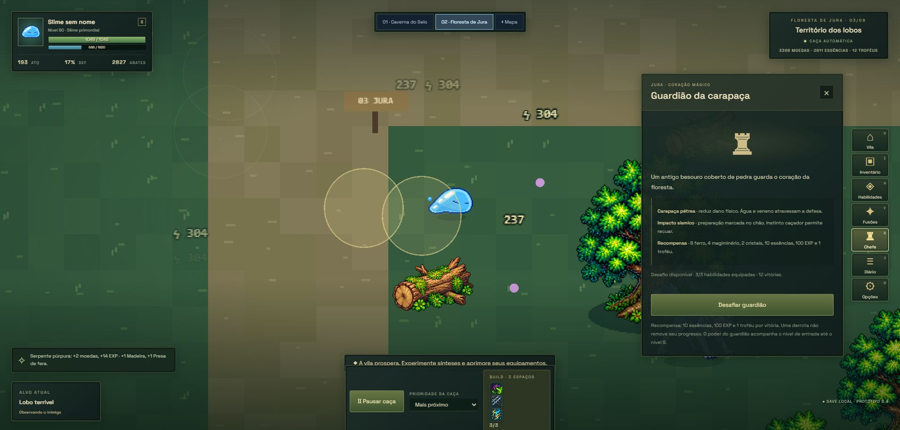

# Slime · Origens — documentação do projeto

Este documento apresenta o jogo, as tecnologias utilizadas e o processo de desenvolvimento com apoio do Codex. As descrições foram conferidas no código-fonte, nos registros de desenvolvimento e nas telas do aplicativo. As capturas foram realizadas em 27/10/2026, no Microsoft Edge, usando a extensão conectada ao navegador e a aplicação local em `http://127.0.0.1:5173/`.

## 1. Apresentação

Slime · Origens é um protótipo de RPG idle para navegador. O jogador acompanha um slime que explora regiões, encontra criaturas e combate automaticamente. A participação do jogador se concentra nas decisões: escolher uma região de caça, organizar habilidades, combinar cópias, administrar recursos, fabricar equipamentos e desenvolver uma vila.

A proposta reúne a leitura visual de RPGs como Tibia com o tema de absorção, evolução e construção de comunidade inspirado em *That Time I Got Reincarnated as a Slime*. O projeto possui regras próprias de progressão e síntese; as receitas são adaptações para o jogo. Conforme os registros de arte, não foram utilizados assets extraídos de Tibia.

O objetivo do protótipo é conectar três atividades: caçar para obter recursos, experimentar combinações para fortalecer o personagem e investir na vila para ampliar suas possibilidades. O combate automático permite que a atenção se volte à preparação e à evolução.

## 2. Funcionamento e apresentação das telas

As figuras abaixo já estão inseridas no Markdown. Ao transferir este conteúdo para um relatório ou apresentação, coloque cada imagem no ponto indicado, mantendo a legenda e a explicação próximas. Todas estão na pasta `imagens`, dentro desta pasta `projeto`.

Os prints registram uma partida com progresso avançado já existente no navegador. Nível, moedas, inventário e construções mostrados são dados dessa sessão e não representam os valores iniciais de uma nova aventura. As capturas mostram a área do aplicativo, sem as barras do Edge.

### 2.1. Exploração e caça automática

O mapa ocupa a janela, com os controles sobrepostos ao cenário. No canto superior esquerdo ficam o retrato, o nível, a vida, a experiência, o ataque, a defesa e os abates. A região atual e os recursos aparecem no canto superior direito. A lateral reúne os menus, enquanto a parte inferior apresenta o objetivo, o alvo, a prioridade de caça e a build equipada.

O slime procura inimigos, aproxima-se e ataca sem exigir comandos repetidos. O jogador pode pausar a caça e escolher uma espécie prioritária. Caverna do Selo e Floresta de Jura oferecem ambientes, criaturas e materiais diferentes.

**Local para inserir a Figura 1:** após a explicação da interface principal.



### 2.2. Inventário e equipamentos

O inventário, acessível pela tecla **I**, apresenta os espaços de arma, armadura e acessório, além da mochila de equipamentos. A aba de recursos permite consultar materiais. Um equipamento fabricado entra na mochila; o jogador precisa equipá-lo para receber seus bônus.

Essa separação entre possuir e equipar um item torna a preparação parte da estratégia. Os equipamentos podem melhorar ataque, defesa, ritmo de combate e recuperação de vida.

**Local para inserir a Figura 2:** junto à descrição dos espaços de equipamento e da mochila.



### 2.3. Absorção e habilidades

Criaturas derrotadas podem fornecer cópias de habilidades. O sistema combina sorteio com uma garantia de absorção para reduzir longos períodos sem recompensa. Cada cópia possui identidade e nível próprios.

A tela de habilidades, aberta com **H**, mostra a build e a coleção. Há três espaços e um limite de seis pontos de magia. A cópia exata escolhida define o poder utilizado; conseguir outra mais forte não substitui automaticamente a equipada. A interface oferece busca, filtros, paginação e proteção por favorito.

**Local para inserir a Figura 3:** após explicar a diferença entre coleção e habilidades equipadas.



### 2.4. Síntese e evolução

A Câmara de Síntese, aberta com **F**, utiliza duas cópias da mochila como ingredientes. Duas habilidades iguais e do mesmo nível podem evoluir. Combinações entre tipos seguem receitas específicas. A progressão das habilidades possui nove níveis, organizados nos estágios Inicial, Superior e Evoluída.

A tela apresenta uma prévia antes da confirmação e lista combinações possíveis com os itens disponíveis. Itens equipados e favoritos ficam protegidos. A prévia permite avaliar o resultado antes de consumir os ingredientes.

**Local para inserir a Figura 4:** junto ao fluxo de seleção de dois ingredientes, prévia e confirmação.



### 2.5. Atlas e planejamento da coleta

O menu **Mapa** reúne um atlas com abas para a caverna e a floresta. As regiões apresentam criaturas, recursos, absorções e nível de perigo. O jogador pode consultar onde obter um material e viajar para o destino desejado.

A Caverna do Selo possui sete setores; a Floresta de Jura possui seis regiões conectadas. A exploração automática pode avançar após seis abates no setor. Essa opção permite alternar entre progressão de rotas e permanência em um local de coleta.

**Local para inserir a Figura 5:** após explicar como o atlas auxilia a escolha de regiões.



### 2.6. Vila e moradores

A vila de Tempest é uma área segura, acessível com **V**. A caça fica suspensa durante a visita. É possível explorar o cenário arrastando a câmera, ajustar o zoom e acessar os serviços dos moradores.

Kaijin atende a oficina e a fabricação de equipamentos; Benimaru se relaciona à análise e à síntese; Shuna oferece alquimia e tônicos; Myourmiles administra o comércio. A vila conecta os recursos das caçadas a melhorias permanentes.

**Local para inserir a Figura 6:** na apresentação da vila e dos moradores.



### 2.7. Forja e uso dos materiais

A Forja de Kaijin permite fabricar arma, armadura e amuleto. A interface apresenta qualidades, bônus, custos e requisitos. As versões simples usam moedas; qualidades superiores exigem recursos e condições da oficina.

O ciclo de fabricação incentiva a consulta ao atlas: identificar a receita, localizar os materiais, coletar nas regiões adequadas, fabricar e equipar o resultado.

**Local para inserir a Figura 7:** após a explicação do ciclo de fabricação.



### 2.8. Comércio e economia

Myourmiles oferece habilidades, equipamentos e materiais em uma caravana com estoque limitado e renovação periódica. O jogador também pode vender cópias e materiais. Itens equipados e favoritos possuem proteção contra venda.

As moedas pertencem à economia interna da partida. O sistema atual funciona com um mercador controlado pelo jogo; não há comércio entre jogadores nem pagamentos com dinheiro real.

**Local para inserir a Figura 8:** junto à apresentação da economia e do estoque da caravana.



### 2.9. Opções e continuidade da partida

O menu **Opções**, aberto com **O**, reúne áudio, tela cheia, exportação e importação de save, restauração por texto e reinício da aventura. O progresso é salvo localmente no navegador, inclusive por salvamento periódico.

O jogo possui uma expedição para períodos de ausência, sujeita a condições de elegibilidade. As recompensas usam ritmo reduzido e limites de duas horas e 240 abates por ausência. Esse cálculo não realiza automaticamente desafios de chefe nem exploração de novas regiões.

**Local para inserir a Figura 9:** após a explicação do salvamento e das opções de continuidade.



### 2.10. Desafios de chefe

A tela de chefe apresenta o inimigo, suas características, requisitos de entrada e recompensas. A caverna possui a Serpente Negra Anciã e a floresta possui o Guardião da carapaça. Esses encontros exigem preparação de habilidades e equipamentos.

Durante o desafio, alterações na build e negociações são restringidas. O combate possui preparação e sinais visuais antes de determinados ataques. A captura registra a tela de preparação do Guardião; não representa uma vitória obtida durante esta sessão de documentação.

**Local para inserir a Figura 10:** após apresentar os desafios e a preparação da build.



## 3. Tecnologias utilizadas e aplicação no projeto

| Tecnologia ou recurso | Como foi utilizado |
| --- | --- |
| TypeScript | Implementação das regras, estados, cenas e interfaces, com verificação estática de tipos e modo estrito. |
| Phaser 3 | Motor 2D responsável por cenas, sprites, animações, câmera, entrada e renderização do mundo. O `package.json` declara `^3.90.0`. |
| Vite | Servidor local de desenvolvimento e empacotamento da versão de produção. O `package.json` declara `^8.0.0`; a faixa permite versões compatíveis. |
| HTML e CSS | Estrutura dos menus, HUD, barras de vida, botões, filtros, janelas e adaptação da interface à janela. |
| Node.js e npm | Execução das ferramentas, instalação de dependências, testes e comandos de desenvolvimento e build. |
| APIs do navegador | `localStorage` para persistência; arquivos JSON para saves; Web Audio API para efeitos sintetizados; API de tela cheia e eventos de visibilidade. |
| PNG e atlas JSON | Imagens com transparência e metadados que identificam os quadros das animações e recortes dos cenários. |
| Python e Pillow | Scripts auxiliares para preparar e analisar assets e gerar atlas. Não são necessários para jogar no navegador. |
| Node Test Runner | Testes automatizados das regras e dos assets, executados com `npm test`. |
| Git | Repositório local para versionamento do código e dos registros do projeto. |
| Codex | Apoio à implementação, revisão, investigação de problemas, execução de verificações e documentação conforme as instruções do autor. |
| Imagegen | Geração assistida de folhas de sprites e outros elementos visuais, com prompts e referências registrados na documentação. |
| Microsoft Edge | Execução e inspeção visual da aplicação; nesta documentação, as telas foram capturadas pela extensão conectada. |

O jogo combina o mundo desenhado pelo Phaser com uma interface HTML/CSS sobreposta. Essa composição permite usar animações e câmera no cenário, mantendo controles convencionais nos menus. A configuração do Phaser utiliza `pixelArt: true`, `antialias: false` e redimensionamento da área de jogo com `Phaser.Scale.RESIZE`.

## 4. Organização e arquitetura

O projeto é uma aplicação web executada no cliente. O servidor do Vite atende ao desenvolvimento; ele não representa um backend de contas ou de partidas. O estado é mantido em memória e persistido no armazenamento local do navegador.

| Arquivo ou grupo | Responsabilidade |
| --- | --- |
| `src/app.ts` | Integração principal entre cenas, estado, eventos, menus, HUD e salvamento. |
| `src/model.ts` | Modelo de progressão, criaturas, habilidades, cópias, fusões, combate e migração de dados. |
| `src/attack-timing.ts` e `src/combat-effects.ts` | Etapas temporais dos ataques e efeitos visuais. |
| `src/cave-*`, `src/forest-*`, `src/world.ts` | Layout, arte, regiões e construção do mundo. |
| `src/grid-navigation.ts` e `src/hunt-navigation.ts` | Navegação e acompanhamento da movimentação durante a caça. |
| `src/village*`, `src/resources.ts` e `src/equipment.ts` | Vila, recursos, construções e equipamentos. |
| `src/*-ui.ts` | Apresentação e interação dos menus de inventário, síntese, mapas, forja e comércio. |
| `src/market.ts`, `src/market-state.ts` e `src/economy.ts` | Regras e estado da economia local. |
| `src/journey.ts` e `src/activity.ts` | Objetivos, leitura de saves, recompensas por ausência e tratamento do tempo de simulação. |
| `public/assets/` | Assets servidos ao navegador. |
| `scripts/` | Ferramentas auxiliares para atlas e dados de demonstração. |
| `tests/` | Testes automatizados. |
| `documentação/` | Planejamento, entregas, decisões, prompts e evidências visuais. |

Essa divisão permite testar regras de inventário, progressão e economia sem depender da renderização de uma cena. A integração principal ainda concentra muitas responsabilidades em `app.ts`, o que representa uma oportunidade de refatoração conforme o protótipo crescer.

## 5. Desenvolvimento com apoio do Codex

Utilizei o Codex como assistente de desenvolvimento, orientado por regras e solicitações específicas para o projeto. Defini a proposta do jogo, as referências visuais, as prioridades e os ajustes esperados. O Codex apoiou a transformação dessas orientações em código, organização de arquivos, testes e documentação.

O uso da ferramenta ocorreu em ciclos de solicitação, implementação, execução e revisão. Por exemplo, a necessidade de absorver poderes levou ao sistema de habilidades; o acúmulo de cópias motivou inventário e síntese; o uso dos materiais foi conectado à vila, à forja e à economia. As entregas foram registradas em documentos de etapas e revisões.

### 5.1. Regras e restrições de trabalho

As orientações registradas no projeto incluem a escolha de Phaser com TypeScript, o mapa ocupando toda a janela, os menus dentro da tela do jogo e o combate automático como base da experiência. A arte do slime fornecida pelo autor deveria ser preservada, e os demais assets deveriam seguir uma direção visual compatível.

As regras de implementação também precisaram respeitar a identidade das cópias, os limites da build, a proteção de favoritos e equipados, a prévia de síntese e a continuidade dos saves antigos. Esses requisitos aparecem tanto no comportamento do código quanto nos registros e testes.

Esses exemplos descrevem orientações e critérios verificáveis no repositório. Não pressupõem a existência de um arquivo único de regras do Codex nem reproduzem instruções internas da ferramenta.

### 5.2. Responsabilidade do autor e papel da IA

O apoio do Codex não elimina as decisões do autor. A ferramenta propõe e implementa soluções a partir das instruções recebidas; o autor define o objetivo, avalia o resultado e direciona as revisões. A inspeção das telas, os testes e os registros permitem conferir se a implementação atende à intenção do projeto.

A IA também foi utilizada na produção visual por meio do Imagegen. Os prompts foram armazenados em arquivos JSON, permitindo consultar referências, especificações e revisões. Após a geração, os assets precisaram ser integrados ao motor: transparência, recortes, escala, origem dos quadros e animações foram tratados separadamente.

## 6. Metodologia e práticas de desenvolvimento

Os registros evidenciam um processo de **prototipação incremental e iterativa**. Primeiro foram definidos plataforma, premissa, interface e ciclo principal. Em seguida, o protótipo recebeu novas funcionalidades em etapas, com revisões motivadas pelo uso e pela inspeção visual.

O ciclo de trabalho pode ser descrito assim:

1. Definir a funcionalidade e suas restrições, como uma síntese que só consome ingredientes após confirmação.
2. Implementar as regras e integrar a interface e os assets necessários.
3. Verificar os tipos e executar testes apropriados às regras alteradas.
4. Abrir o aplicativo no navegador e observar apresentação e interação.
5. Corrigir problemas, registrar decisões e iniciar a próxima melhoria.

Isso caracteriza entregas pequenas e revisão frequente. Os documentos consultados não comprovam adoção formal de Scrum, sprints com duração fixa ou cerimônias de uma equipe. Também não comprovam que os testes foram sempre escritos antes do código; portanto, o processo é descrito como desenvolvimento acompanhado por testes, sem atribuir TDD a todas as etapas.

### 6.1. Testes e verificação

Os testes cobrem progressão, migração, inventário, identidade de cópias, síntese, economia, recursos, vila, mapas, navegação, tempo de ataque e integridade de assets. O build verifica os tipos antes de gerar os arquivos de produção.

A verificação visual complementa os testes de regras: ela permite observar legibilidade, alinhamento, escala dos sprites e organização dos menus. Nesta sessão foram abertos e capturados os dez estados de interface apresentados neste documento. As capturas não constituem uma nova validação de todas as transações, receitas, chefes ou condições de ausência. Nenhum resultado novo da suíte de testes é atribuído a esta atividade de documentação.

### 6.2. Persistência e compatibilidade

O save usa JSON no `localStorage`. A função de migração adapta dados de versões anteriores, enquanto a importação valida a estrutura recebida. A exportação permite guardar uma cópia fora do navegador.

Como o armazenamento é local, o progresso depende do navegador, do perfil e da origem utilizada. `localhost` e `127.0.0.1`, por exemplo, possuem armazenamentos distintos. O save é editável e não oferece a autoridade de um servidor para inventário ou economia compartilhada.

### 6.3. Arte e integração visual

A folha original do slime foi preservada e utilizada como referência. Os demais elementos visuais passaram por gerações e revisões documentadas. Os atlas JSON indicam os recortes das imagens; as animações utilizam esses quadros no Phaser.

As revisões tratam de problemas concretos: proporção entre criaturas, alinhamento das poses, margens transparentes, leitura de golpes e composição dos mapas. Os documentos antigos descrevem fases anteriores da arte; para a aparência atual da vila, devem ser usadas as capturas desta pasta.

## 7. Como executar

É necessário Node.js compatível com o Vite utilizado e npm. O README principal indica Node.js 22.12+ ou 24+ para o Vite; os testes com remoção nativa de tipos requerem Node.js 22.18+ ou 24+.

Na raiz do projeto:

```powershell
npm install
npm run dev
```

Abra o endereço informado pelo terminal, normalmente `http://127.0.0.1:5173/`. Para os testes e a versão de produção:

```powershell
npm test
npm run build
npm run preview
```

O build gera a pasta `dist/`, que pode ser atendida por uma hospedagem estática. O aplicativo deve ser aberto por um servidor HTTP; abrir diretamente o HTML pelo sistema de arquivos não substitui esse fluxo.

## 8. Limitações e possibilidades de evolução

O resultado atual é um protótipo individual com exploração, caça automática, absorção, síntese, equipamentos, coleta, vila, comércio e desafios. O planejamento contém propostas além do que já foi implementado; elas não devem ser apresentadas como funcionalidades prontas.

Possibilidades de evolução incluem balanceamento com sessões reais, revisão de telas menores, ampliação de conteúdo e redução das responsabilidades concentradas na integração principal. Contas, sincronização entre dispositivos e comércio entre jogadores exigiriam infraestrutura adicional, com validação e persistência no servidor.

## 9. Fontes internas e arquivos de apoio

O conteúdo técnico foi elaborado a partir de `package.json`, `tsconfig.json`, módulos de `src/`, testes e registros do próprio projeto. Para aprofundamento:

- [README principal](../../README.md) — execução e visão geral.
- [Planejamento](../planejamento.md) — proposta inicial e decisões.
- [Inventário e economia](../inventario-e-economia.md) — cópias, equipamentos, migração e comércio.
- [Forja e recursos](../forja-recursos-continuidade.md) — integração entre coleta e fabricação.
- [Floresta de Jura](../floresta-de-jura.md) — regiões e materiais.
- [Sprites](../sprites.md) — origem da arte e integração de atlas.
- [Combate visual](../combate-visual.md) — animações e leitura dos ataques.
- [Ícones, caravana e menus](../icones-caravana-menus.md) — revisões da interface.

Os documentos anteriores registram o estado de suas respectivas entregas. Em caso de diferenças entre uma descrição histórica e o funcionamento atual, confira o código e a interface da versão em execução.
